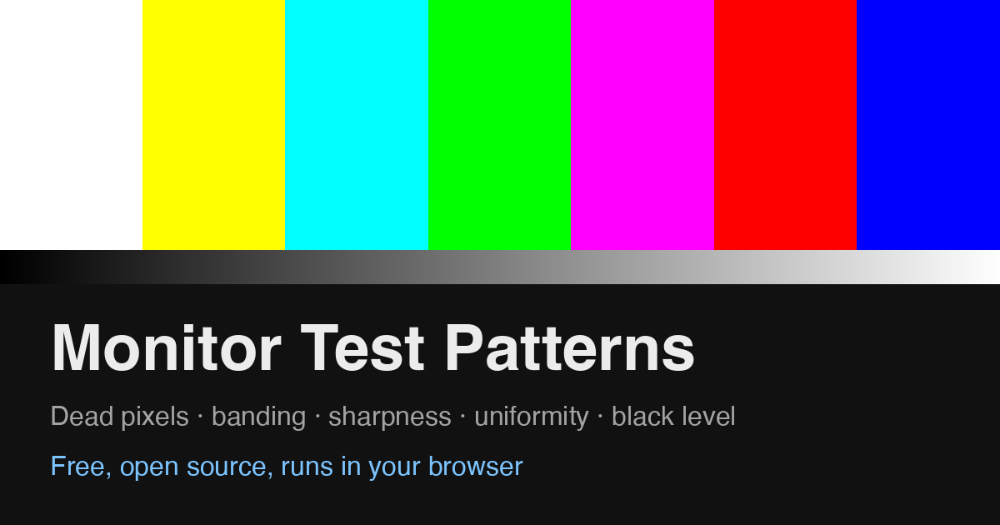

# Monitor Test Patterns

Free fullscreen monitor test patterns that run in any browser. Use them to check a display for dead or stuck pixels, gradient banding, sharpness, backlight uniformity, black level and white level.

**▶ Open the patterns: https://naughtywombat.github.io/monitor-test-patterns/**



It's a single HTML file with no dependencies, no build step and no tracking. Open it online, or download `index.html` and use it offline, for example from a USB stick when you're checking a monitor in a shop.

## Patterns

| Pattern | What it checks |
|---|---|
| White | Dead pixels, dim corners, tint |
| Black | Stuck pixels, backlight bleed, IPS glow |
| Red / Green / Blue | Stuck or dead subpixels |
| 50% gray | Uniformity, dirty-panel effect, color tint |
| Gray ramp | Banding in smooth gradients (6-bit vs 8-bit color) |
| Color ramps | Banding in each RGB channel |
| Black level | Shadow detail, RGB 1–20 on black (crushed blacks) |
| White level | Highlight detail, RGB 235–254 on white (clipping) |
| 1px checkerboard | Sharpness, scaling, pixel inversion |
| Grid | Geometry, alignment, overscan cropping |
| Color bars | Color reproduction and bleeding |

Patterns are drawn at the display's device pixel ratio, so 1-pixel lines are one *physical* pixel wide on Retina and other high-DPI displays.

## Usage

| Key | Action |
|---|---|
| `→` / `Space` / tap right half | Next pattern |
| `←` / tap left half | Previous pattern |
| `F` | Toggle fullscreen |
| `H` | Show or hide the pattern name |
| `Esc` | Close |

Each pattern has its own deep link, for example [`#black`](https://naughtywombat.github.io/monitor-test-patterns/#black) or [`#gray-ramp`](https://naughtywombat.github.io/monitor-test-patterns/#gray-ramp).

**Tips:** let the monitor warm up for about 15 minutes, use its native resolution with 100% scaling, and do the black and uniformity checks in a dark room.

## Run locally

```sh
git clone https://github.com/NaughtyWombat/monitor-test-patterns.git
open monitor-test-patterns/index.html   # or just double-click it
```

## Related

For guided monitor tests with step-by-step explanations, a refresh rate test and an OLED burn-in test, see [monitortest.cc](https://monitortest.cc).

## Contributing

Pattern ideas and fixes are welcome. Open an issue or a pull request.

## License

[MIT](LICENSE)
